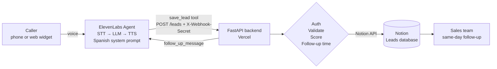

# Eliza — AI Voice Agent for Commercial Real Estate Lead Qualification

**A Spanish-speaking voice agent that answers every inbound inquiry immediately, qualifies the lead in a natural conversation, scores it with a transparent rule and drops it into a Notion pipeline, ready for same-day follow-up.**

Built with ElevenLabs Agents · FastAPI · Pydantic · Notion API · Vercel

---

## The business problem

I lease and sell commercial properties (retail units, offices, warehouses and land) in Toluca and Metepec, Mexico. Inquiries arrive by phone and through the website at all hours, and the first response was slow and inconsistent:

- Calls outside business hours or during showings went unanswered.
- Each conversation collected different information, so follow-up started with a second round of questions.
- There was no way to tell, at a glance, which leads deserved a call back first.

In commercial real estate the first serious response often wins the deal. The goal: **respond instantly, ask the same qualifying questions every time, and hand off a structured, prioritized lead that a person can act on the same day.**

## What it does

1. **Eliza** (the ElevenLabs agent) picks up the phone or web chat and talks in warm, professional Mexican Spanish.
2. She qualifies the lead conversationally, **one question at a time**, collecting: name, contact, company and business type, property type, lease or purchase, size and zone, budget, timing, decision role and notes.
3. If the lead is unsure about budget, she offers reference ranges instead of insisting.
4. She reads the key details back and waits for confirmation.
5. She calls the backend tool `save_lead`. The backend validates the data, **scores the lead (Hot / Warm / Cold)**, computes a follow-up deadline from business hours and creates the page in Notion with status **New**.
6. She closes the call by telling the lead exactly when a person will contact them.

She never invents availability or prices; a human advisor follows up with real options.

## Architecture



### Design principle: the LLM talks, the code decides

| Responsibility | Where it lives | Why |
|---|---|---|
| Conversation, tone, asking one question at a time, offering budget ranges | LLM (system prompt) | Language is what LLMs are good at |
| Mapping free speech to fixed categories | LLM, constrained by the tool's **enums** | The model can only choose from allowed values |
| Validation (types, required fields, contact method) | Pydantic | Bad data is rejected with readable errors |
| **Lead scoring** | Python (`app/scoring.py`) | Deterministic, auditable, easy to change |
| **Follow-up promise** | Python (`app/followup.py`) | The agent can never promise a time the team can't meet |
| Persistence | Notion API | The pipeline the team already uses |

### Reliability details

- **Idempotent saves.** ElevenLabs injects `system__conversation_id` into every tool call. If the same conversation is saved twice (a retry, or the lead corrects something), the backend **updates** the existing page instead of creating a duplicate, and it never resets a Status the team already changed.
- **Never lose a lead over formatting.** A spoken email that doesn't parse goes into Notes instead of failing the request. A budget range given backwards is swapped. `0` is treated as "not given".
- **Caller ID as fallback.** On phone calls, `system__caller_id` is captured automatically, so there is always a way to call back.
- **Recoverable failures.** If Notion is down, the backend returns a clear 502 and logs the full payload so the lead can be entered by hand. The agent is instructed to close the call gracefully without mentioning technical errors.

## Lead scoring

Scoring happens in the backend, not the LLM, so it is consistent and explainable. Three signals:

| Signal | Met when |
|---|---|
| **Decision maker** | `decision_role = decision_maker` |
| **Budget defined** | a minimum or maximum budget was given (accepting one of the offered ranges counts) |
| **Timing ≤ 3 months** | `timeframe` is `immediate` or `1_3_months` |

| Signals met | Score |
|---|---|
| 3 | 🔴 **Hot** |
| 2 | 🟠 **Warm** |
| 0–1 | 🔵 **Cold** |

Every lead also gets a **Score reason** in Notion, e.g. `decision maker ✓ · budget ✓ · timing ✗ (3–6 months)`, so anyone can see why a lead was ranked that way.

**To adjust the rule**, edit [`app/scoring.py`](app/scoring.py):
- Change which timeframes count as "soon" in `FAST_TIMEFRAMES`.
- Change the thresholds in `score_lead()`, or add a signal (for example, minimum budget by property type).
- Update the expectations in [`tests/test_scoring.py`](tests/test_scoring.py) and run `pytest`.

## Follow-up commitment

The backend decides when a person will contact the lead and returns a sentence the agent reads aloud. Default schedule (Toluca time): Mon–Fri 9:00–18:00 and Sat 10:00–14:00.

- A lead that arrives on a business day **at least 2 hours before closing** → *"hoy antes de las 6:00 de la tarde"*
- Otherwise → **next business day before noon** → *"mañana antes del mediodía"* / *"el lunes antes del mediodía"*

The same deadline is stored in Notion's **Follow-up by** column, so you can sort the pipeline by it. Edit `BUSINESS_HOURS`, `CUTOFF_HOURS` and `NEXT_DAY_DEADLINE` in [`app/followup.py`](app/followup.py) to change it.

## Notion database schema

| Property | Type | Values / notes |
|---|---|---|
| Name | Title | Full name |
| Status | Select | **New** (default), Contacted, Visit scheduled, Proposal sent, Won, Lost |
| Score | Select | Hot, Warm, Cold |
| Score reason | Text | Generated by the backend |
| Phone | Phone | Stated phone, or caller ID as fallback |
| Email | Email | |
| Company | Text | |
| Business type | Select | Restaurant, Clinic, Retail store, Office, Industrial/Logistics, Other |
| Property type | Select | Retail unit, Office, Warehouse, Land |
| Operation | Select | Lease, Purchase |
| Space (m²) | Number | |
| Zone | Text | |
| Budget min (MXN) | Number (peso) | Monthly rent when leasing, total price when buying |
| Budget max (MXN) | Number (peso) | |
| Timeframe | Select | Immediate (<1 mo), 1–3 months, 3–6 months, 6+ months, Undefined |
| Decision role | Select | Decision maker, Influencer, Researching for someone else |
| Notes | Text | |
| Follow-up by | Date | Computed by the backend |
| Source | Select | Voice agent – phone, Voice agent – web |
| Conversation ID | Text | Links to the transcript in ElevenLabs; used for deduplication |
| Created | Created time | Automatic |

> Status is a **Select** rather than Notion's "Status" type because the Notion API cannot create Status properties. It works the same for filters and board views.

`scripts/setup_notion_db.py` creates this schema automatically. If you build it by hand, property names and option labels must match exactly.

## Project structure

```
lead-agent/
├── app/
│   ├── main.py          # FastAPI app: /leads, /health, auth, logging, error handling
│   ├── config.py        # Environment variables (fails fast if one is missing)
│   ├── models.py        # Pydantic payload, enums and Notion labels
│   ├── scoring.py       # Hot / Warm / Cold rule
│   ├── followup.py      # Business-hours follow-up commitment
│   └── notion.py        # Notion API client (create / update page)
├── agent/
│   ├── system_prompt.es.md   # Eliza's system prompt (Spanish)
│   ├── first_message.es.txt  # Opening line
│   └── save_lead_tool.json   # ElevenLabs server tool definition
├── scripts/
│   ├── setup_notion_db.py    # Creates the Notion database
│   └── send_test_leads.py    # Sends a Hot, a Warm and a Cold sample lead
├── tests/                    # Scoring, follow-up and endpoint tests (Notion mocked)
├── api/index.py              # Vercel entry point
├── vercel.json               # Vercel routing
├── render.yaml               # Render blueprint (alternative host)
├── requirements.txt
└── .env.example
```

## Setup

### 1. Local environment

```bash
cd lead-agent
python3 -m venv .venv && source .venv/bin/activate
pip install -r requirements-dev.txt
cp .env.example .env
python3 -c "import secrets; print(secrets.token_urlsafe(32))"   # paste into WEBHOOK_SECRET
pytest                                                           # 26 tests, no credentials needed
```

### 2. Notion

1. Go to <https://www.notion.so/my-integrations> → **New integration** (internal). Copy the secret into `NOTION_API_KEY`.
2. In Notion, create a page such as "CRM". Open **⋯ → Connections** and add your integration.
3. Copy that page's URL and run:
   ```bash
   python scripts/setup_notion_db.py "https://www.notion.so/CRM-<page-id>"
   ```
4. Put the printed ID in `NOTION_DATABASE_ID`.

### 3. Run and test locally

```bash
uvicorn app.main:app --reload
python scripts/send_test_leads.py          # in another terminal
```

Three pages appear in Notion: one Hot, one Warm, one Cold. The script also sends a request with a wrong secret and expects `401`. Running it again updates the same three pages, which demonstrates deduplication.

### 4. Deploy to Vercel

The app runs as a Python serverless function: `api/index.py` exposes the FastAPI app and `vercel.json` routes every path to it. Serverless instances start in about a second, so no keep-alive pinger is needed.

1. Push `lead-agent/` to a GitHub repository (`.env` is ignored by git).
2. In Vercel: **Add New → Project**, import the repository. Framework preset: **Other**. Leave build settings empty.
3. Under **Environment Variables**, add `NOTION_API_KEY`, `NOTION_DATABASE_ID` and `WEBHOOK_SECRET`, then **Deploy**.
4. Open `https://<your-project>.vercel.app/health` → `{"status":"ok"}`.
5. Test the deployed endpoint: `python scripts/send_test_leads.py https://<your-project>.vercel.app`

Use the **production** domain (`<your-project>.vercel.app`) in ElevenLabs. Preview deployment URLs sit behind Vercel's login wall and will reject the agent. Vercel's Hobby plan is for non-commercial use; move to Pro (or Render's paid tier) for real client traffic.

#### Alternative: Render

`render.yaml` is included. In Render: **New → Blueprint**, select the repo and fill in the same three variables. Render's free tier sleeps after 15 minutes idle and takes 30–60 s to wake, so add a free [UptimeRobot](https://uptimerobot.com) monitor on `/health` every 5 minutes.

### 5. ElevenLabs agent

1. In ElevenLabs, go to **Agents → Create agent** (blank template).
2. **Language:** Spanish. **Voice:** pick a Mexican Spanish voice from the Voice Library. Warm, mid-paced voices work best.
3. **First message:** paste [`agent/first_message.es.txt`](agent/first_message.es.txt).
4. **System prompt:** paste [`agent/system_prompt.es.md`](agent/system_prompt.es.md).
5. **LLM:** choose a model with strong tool calling from the dropdown.
6. **Secret:** add a workspace secret (for example `lead_webhook_secret`) with the same value as `WEBHOOK_SECRET`.
7. **Tool:** **Tools → Add tool → Webhook**, and configure it to match [`agent/save_lead_tool.json`](agent/save_lead_tool.json):
   - Name `save_lead`, method `POST`, URL `https://<your-project>.vercel.app/leads`
   - Header `X-Webhook-Secret` → value from the secret created above
   - Body parameters exactly as in the JSON (types, enums, descriptions, required list). `conversation_id` and `caller_id` are **dynamic variables** (`system__conversation_id`, `system__caller_id`), not LLM-filled.
   - Response timeout: 20 s
   - (Using the API? The JSON file is already in the tool-config shape. Replace the URL and `secret_id`.)
8. **Channels:**
   - *Phone:* in **Phone Numbers**, import a Twilio number (or SIP trunk) and assign the agent.
   - *Web:* copy the widget embed snippet into your website.
9. Use the built-in **Test** button for a few practice conversations, then check the lead in Notion.

## Security

- The webhook only accepts requests with the correct `X-Webhook-Secret`. It's compared with `hmac.compare_digest`, which takes the same time regardless of where a mismatch occurs, so the secret can't be guessed from response timing.
- Secrets live only in environment variables (`.env` locally, the hosting dashboard in production) and in ElevenLabs' secret store. Nothing is hardcoded or committed.
- The agent itself is told to never quote prices, availability or legal and financial advice, and never to reveal the internal lead score.
- Logs contain lead data (needed for recovery when Notion fails). Hosting logs are private to your account, so treat them as sensitive. Vercel's Hobby plan keeps runtime logs only briefly, so check them soon after a failure.

## Testing

```bash
pytest -v
```

- `test_scoring.py`: every combination of the Hot / Warm / Cold rule, plus data normalization.
- `test_followup.py`: business-hours edge cases (before opening, after cutoff, Friday night, Saturday, Sunday).
- `test_api.py`: the full endpoint with Notion mocked (auth, validation errors, create, deduplicated update, Notion failure).

## Possible next steps

- WhatsApp or email confirmation to the lead after the call.
- Instant Slack/WhatsApp alert to the sales team for Hot leads.
- Use ElevenLabs post-call webhooks to attach the transcript and recording link to the Notion page.
- Match leads against a property inventory once a structured inventory exists.
